# Active Directory Home Lab

> **Status:** ✅ Core lab complete. Domain controller, PowerShell provisioning, Group Policy, help-desk account lifecycle, and least-privilege delegation. Next: a domain-joined Windows 11 client and forwarding logs to Splunk.

## Overview
A home lab that simulates a small company's Windows identity environment. The goal is hands-on practice with **identity and access management (IAM)**: building a domain, organizing users into OUs, managing security groups, and automating user provisioning.

## Lab Environment
| Component | Details |
|---|---|
| Host | Windows PC running VirtualBox |
| Domain Controller | Windows Server 2022 Standard Evaluation (Desktop Experience), hostname `DC01` |
| VM resources | 2 vCPU, 4 GB RAM, 50 GB disk |
| Domain | `lab.local` (NetBIOS: `LAB`) |
| Network | VirtualBox NAT (default) |

## Skills Demonstrated
- Installing Windows Server 2022 in a virtual machine
- Installing the AD DS role and promoting a server to a domain controller (new forest, integrated DNS)
- Designing an OU structure by department
- Creating security groups and organizing users by role
- Automating user provisioning with PowerShell from a CSV
- Enforcing a password change at first logon for new accounts
- Configuring a domain password and account lockout policy with Group Policy and verifying it with PowerShell
- Creating and linking a department-specific GPO to an OU
- Help-desk account tasks with PowerShell: testing lockout, unlocking accounts, and resetting passwords
- Offboarding a user: disabling the account, removing group access, documenting, and moving to a Disabled Users OU
- Least-privilege delegation: letting a help-desk group reset passwords only in specific OUs, without Domain Admin rights

## Build Steps

### 1. Install Windows Server 2022
Created a VirtualBox VM, installed Windows Server 2022 with Desktop Experience, and renamed the server to `DC01`.

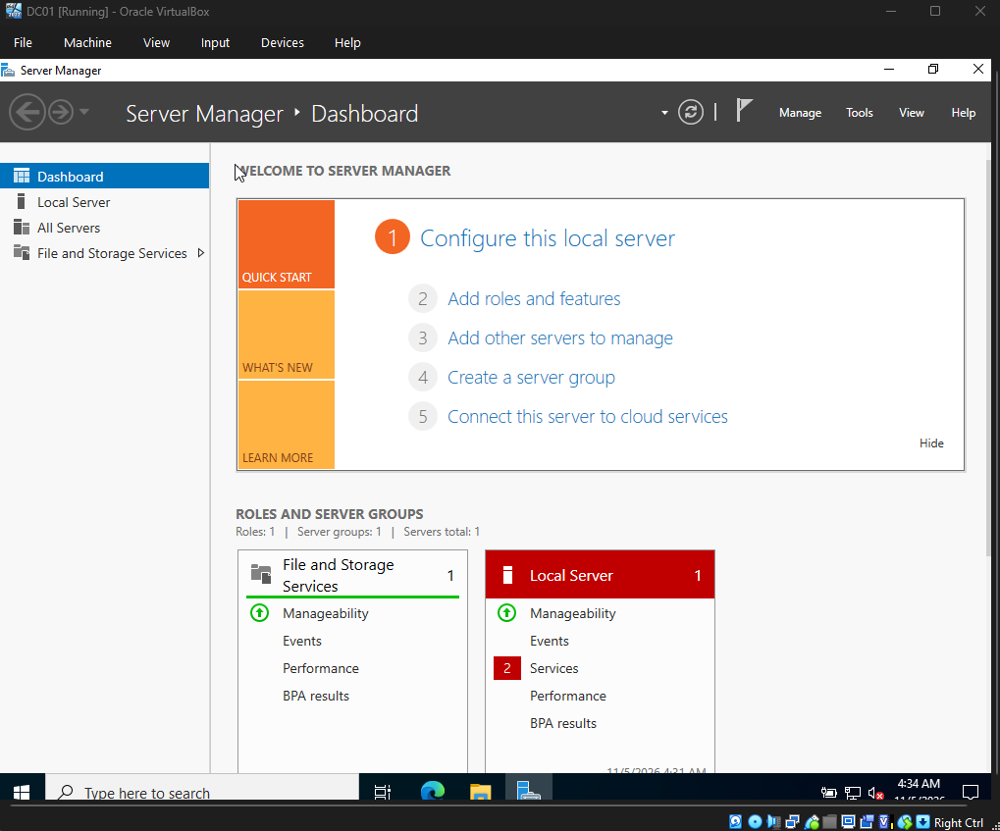

### 2. Install AD DS and create the domain
Added the **Active Directory Domain Services** role in Server Manager, then promoted the server to a domain controller in a new forest, `lab.local`. DNS was installed as part of the promotion.

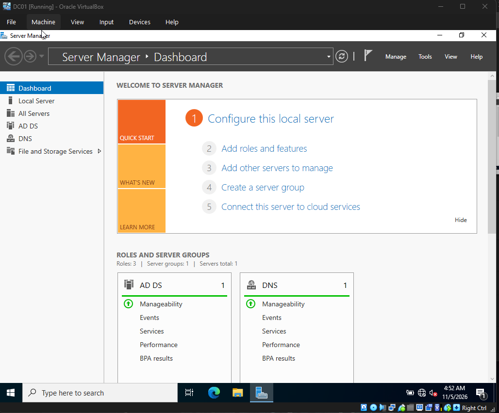

### 3. Provision users with PowerShell
Wrote [`scripts/Create-LabUsers.ps1`](scripts/Create-LabUsers.ps1), which reads [`scripts/users.csv`](scripts/users.csv) and for each user:
- creates the department OU if it doesn't exist (`IT`, `HR`, `Sales`)
- creates a department security group (`SG-IT`, `SG-HR`, `SG-Sales`) in a `Groups` OU
- creates the user (username = first initial + last name) in their department OU
- adds the user to their department group
- requires a password change at first logon

Result: 4 OUs, 3 security groups, 8 users.

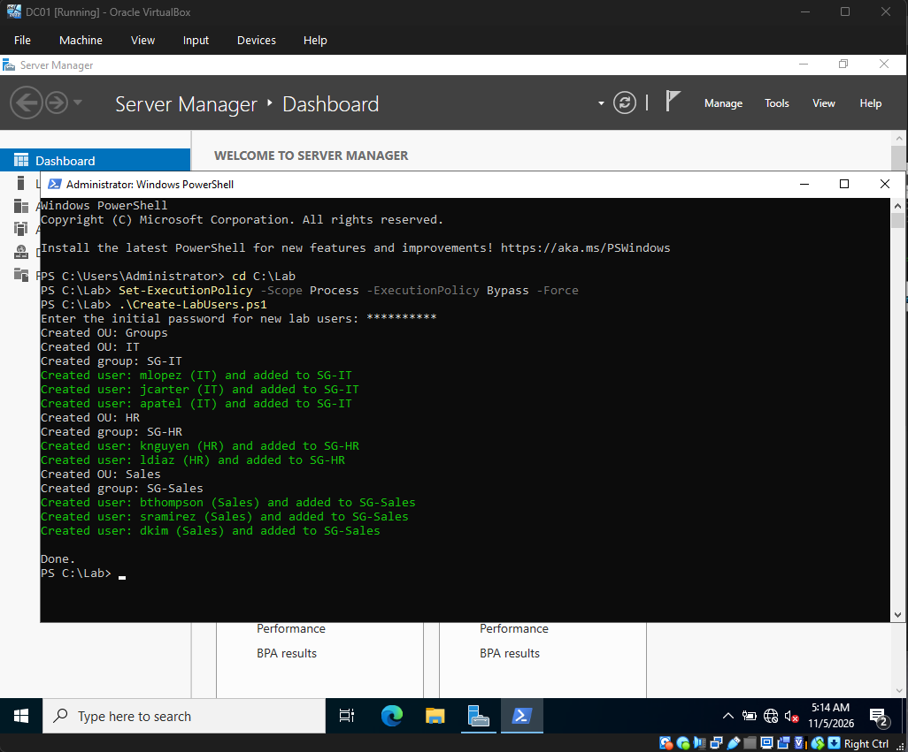

### 4. Verify in Active Directory Users and Computers
Confirmed the OU structure and users in ADUC.

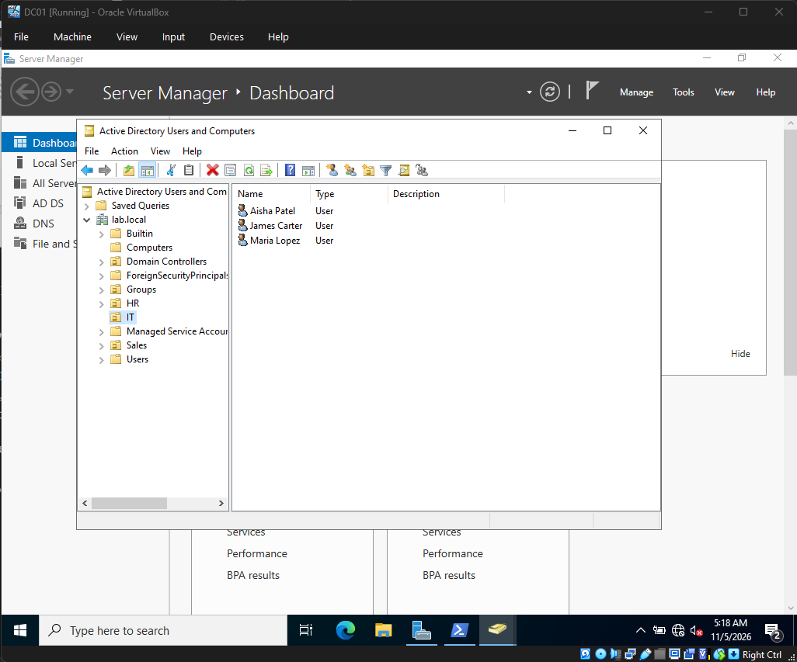

### 5. Password and account lockout policy (Group Policy)
Edited the **Default Domain Policy** in Group Policy Management to enforce:

| Setting | Value |
|---|---|
| Minimum password length | 12 characters |
| Password complexity | Enabled |
| Enforce password history | 24 passwords |
| Maximum password age | 90 days |
| Account lockout threshold | 5 invalid attempts |
| Account lockout duration | 15 minutes |
| Reset lockout counter after | 15 minutes |

The lockout policy defends against brute-force and password-spraying attacks. Each lockout also generates Windows event ID 4740, which I'll alert on in my SOC lab.

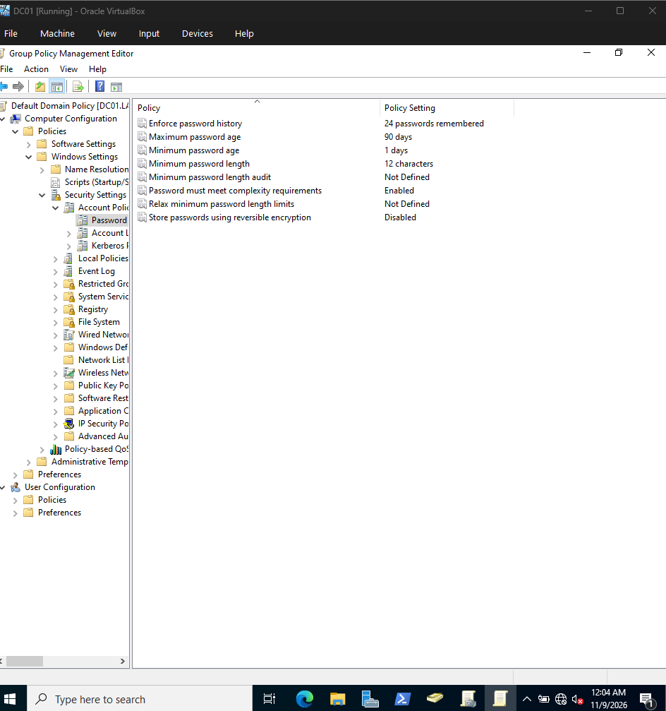
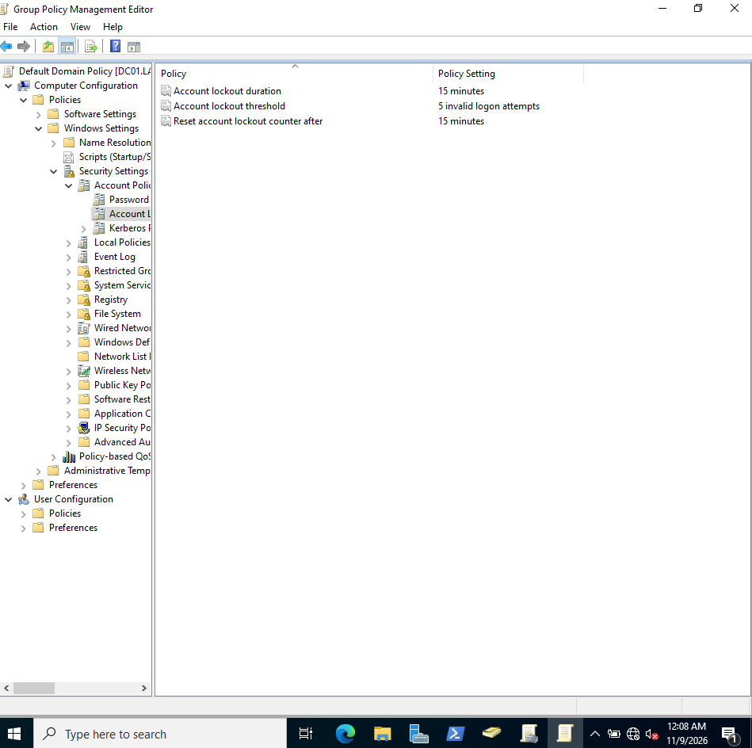

Applied the policy with `gpupdate /force` and verified the effective settings with `Get-ADDefaultDomainPasswordPolicy`:

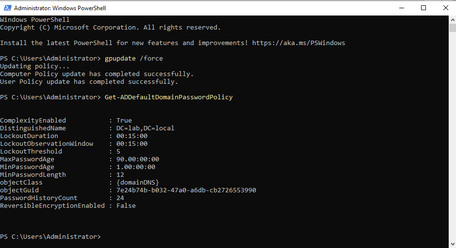

### 6. Department GPO: restrict Control Panel for Sales
Created a GPO named **Sales - Restrict Control Panel** and linked it to the `Sales` OU. It enables *User Configuration → Administrative Templates → Control Panel → Prohibit access to Control Panel and PC settings*, so Sales users can't change system settings while other departments are unaffected.

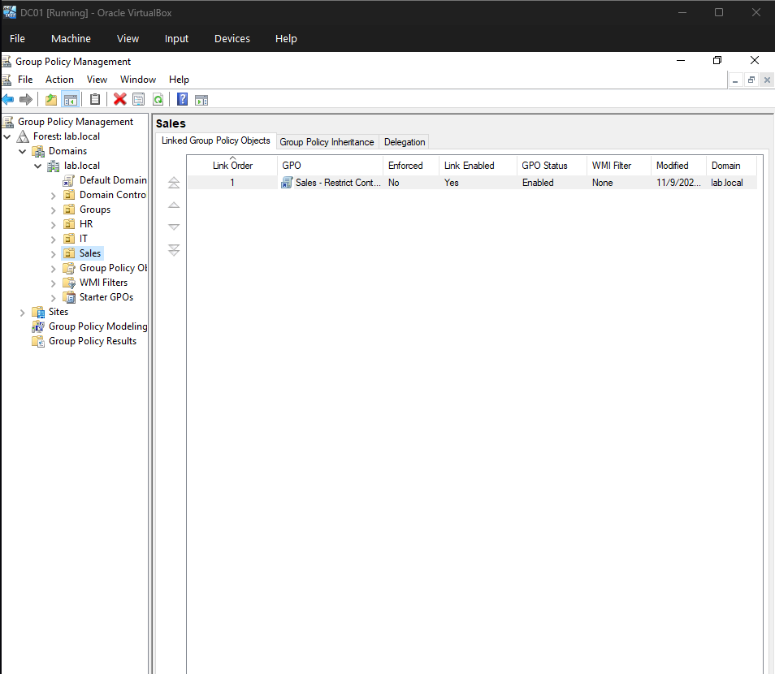

### 7. Help-desk tasks: lockout, unlock, password reset
**Tested the lockout policy** by simulating 6 failed logons against `jcarter`. The account locked after 5 attempts, as configured:
```powershell
1..6 | ForEach-Object { net use \\DC01\IPC$ /user:LAB\jcarter WrongPass$_ 2>$null }
Get-ADUser jcarter -Properties LockedOut, BadLogonCount | Select-Object Name, LockedOut, BadLogonCount
```
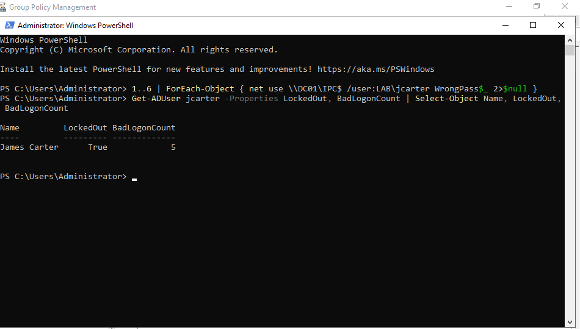

**Handled it like a help-desk ticket:** unlocked the account, reset the password to a temporary one, and required a change at next logon:
```powershell
Unlock-ADAccount -Identity jcarter
Set-ADAccountPassword -Identity jcarter -Reset -NewPassword (Read-Host -AsSecureString "New temporary password")
Set-ADUser -Identity jcarter -ChangePasswordAtLogon $true
```
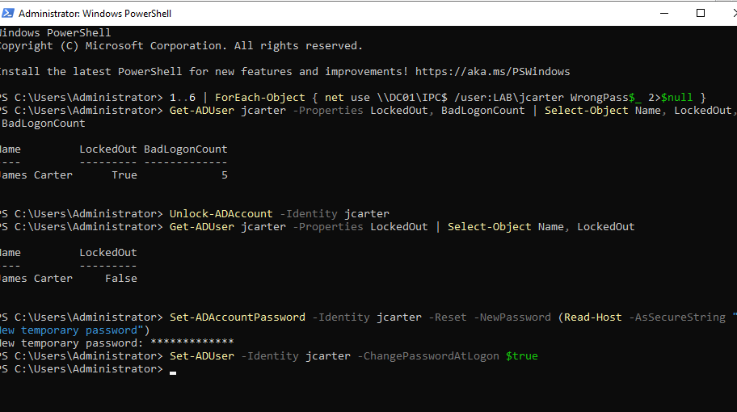

### 8. Offboarding a departing employee
Simulated Laura Diaz (HR) leaving the company. Instead of deleting the account, which would lose the audit trail, I:
- disabled the account
- removed her from `SG-HR` to revoke access
- added a dated offboarding note to the description
- moved her to a new `Disabled Users` OU

```powershell
New-ADOrganizationalUnit -Name "Disabled Users" -Path "DC=lab,DC=local"
Disable-ADAccount -Identity ldiaz
Remove-ADGroupMember -Identity SG-HR -Members ldiaz -Confirm:$false
Set-ADUser -Identity ldiaz -Description "Offboarded 11/9/2026 - left company"
Get-ADUser ldiaz | Move-ADObject -TargetPath "OU=Disabled Users,DC=lab,DC=local"
```
Verification shows `Enabled: False`, the note, the new OU, and no remaining group memberships.

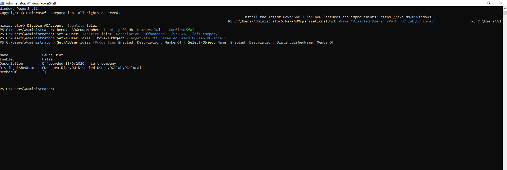

### 9. Least-privilege delegation for the help desk
Created an `SG-HelpDesk` security group and added the help-desk technician (`jcarter`). Using the **Delegation of Control Wizard**, I gave the group permission to **reset user passwords and force a password change at next logon** in the `HR` and `Sales` OUs only.

The `IT` OU was left out on purpose, so help-desk staff can't reset IT administrators' passwords. The help desk handles routine tickets without needing Domain Admin rights.

```powershell
New-ADGroup -Name "SG-HelpDesk" -GroupScope Global -GroupCategory Security -Path "OU=Groups,DC=lab,DC=local"
Add-ADGroupMember -Identity SG-HelpDesk -Members jcarter
```
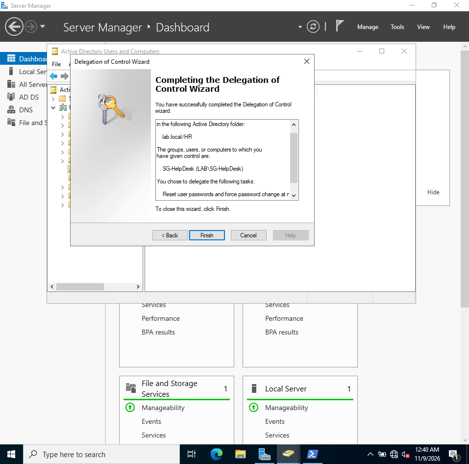

## What I Learned
- Installing a role (AD DS) and promoting a server to a domain controller are two separate steps.
- Promoting the first DC creates the forest and domain and sets up DNS, which Active Directory depends on.
- Scripting user creation from a CSV is faster and more consistent than creating accounts by hand, and the CSV acts as a record of who was provisioned.
- Domain-wide password and lockout rules belong in the Default Domain Policy, and it's important to verify the effective policy instead of assuming a change applied.
- Testing a control matters: simulating failed logons proved the lockout policy actually works.
- Offboarding should disable, not delete, so the account history stays available for audits and investigations.
- Delegation lets the help desk do its job without handing out Domain Admin, which is least privilege in practice.
- VirtualBox's unattended install failed with a "cannot find license terms" error. I fixed it by swapping the auto-install disc for the real ISO and installing manually.

## Next Steps
- [x] Group Policy: password and account lockout policy
- [x] Department GPO (restrict Control Panel for Sales)
- [x] Help-desk tasks: lockout test, unlock, password reset
- [x] Offboarding a departed user
- [x] Delegate password-reset rights to a help-desk group (least privilege)
- [ ] Join a Windows 11 client to the domain, log in as a domain user, and confirm GPOs apply with `gpresult /r`
- [ ] Connect this domain to my separate [SOC lab](https://github.com/mickeykali/soc-lab), forwarding DC01's security logs to Splunk to detect identity attacks
